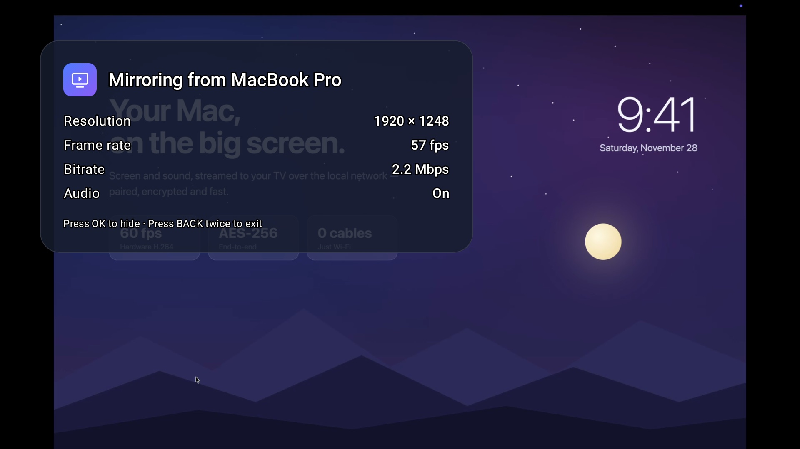
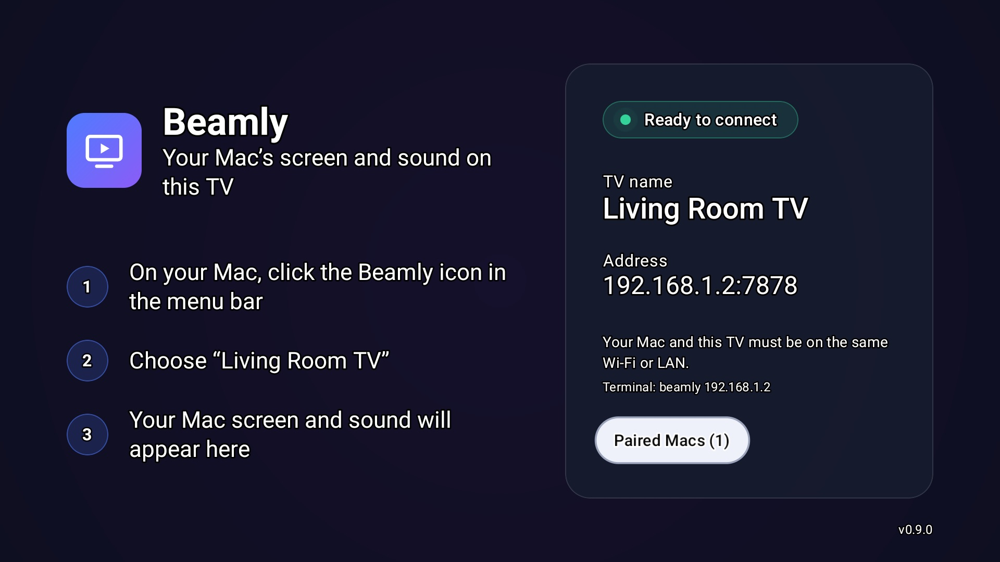
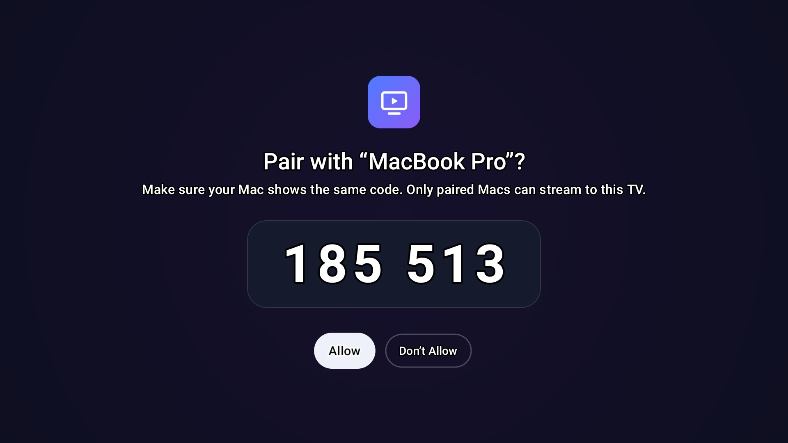
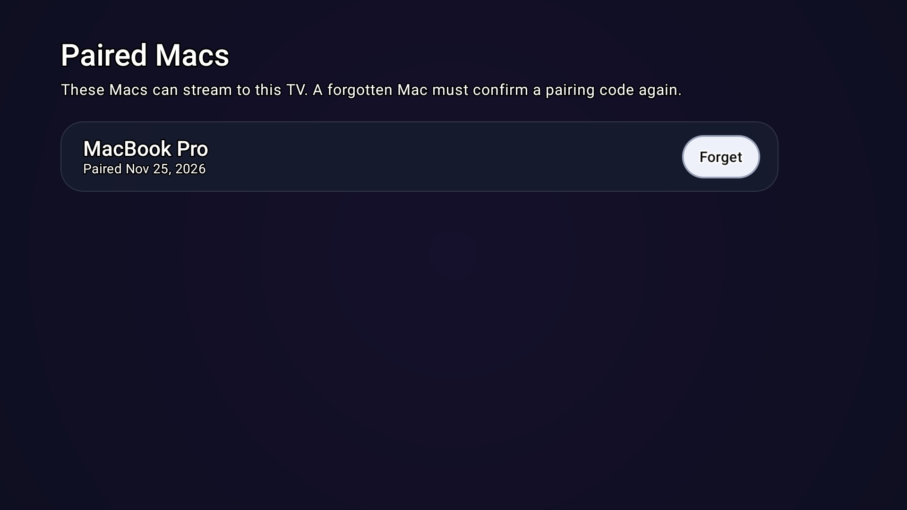

<p align="center">
  
</p>

<p align="center">
  <b>Mirror your Mac's screen and sound to an Android TV on your local network.</b><br>
  Low latency · hardware encoding and decoding · no cloud, no account, no cables
</p>

<p align="center">
  <a href="https://github.com/ledhcg/beamly/actions/workflows/ci.yml"></a>
  <a href="LICENSE"></a>
  
  
</p>

> **Status: pre-1.0.** Streams are paired and end-to-end encrypted; the protocol may still change before 1.0.
> See [Security](#security).

<p align="center">
  
</p>

## Features

- **Screen mirroring** at up to 1440p / 60 fps with VideoToolbox (Mac) and MediaCodec (TV) hardware codecs.
- **System audio on the TV.** Optionally keeps the Mac's speakers silent while streaming, and the Mac's volume
  keys control the TV like any other audio output.
- **Zero configuration.** The TV advertises itself over Bonjour/DNS-SD; the Mac finds it automatically.
- **Menu bar app** with quality, frame rate, display and audio settings, plus a **command-line sender** for scripts.
- **10-foot TV interface** built with Compose for TV: works with a D-pad, shows stream details on demand.
- **Paired and encrypted:** a Mac must be approved on the TV once, by comparing a 6-digit code on both screens;
  every session is authenticated and encrypted with AES-256-GCM.
- **Resilient sessions:** heartbeats, clean stop signalling, automatic recovery when either side disappears.

## Requirements

| | Minimum |
|---|---|
| Mac | macOS 14.2 (Sonoma) or later, Apple silicon or Intel |
| TV | Android TV / Google TV 8.0 (API 26) or later with an H.264 hardware decoder |
| Network | Mac and TV on the same Wi-Fi or Ethernet network; 5 GHz Wi-Fi or Ethernet recommended |

## Installation

Pre-built downloads will be attached to [GitHub Releases](https://github.com/ledhcg/beamly/releases) starting with
the first public release (a signed and notarized `Beamly.dmg`, the `beamly` CLI, and `beamly-tv.apk`).
Until then, [build from source](#building-from-source).

**TV:** install the APK with `adb`:

```sh
adb connect <tv-address>:5555   # enable "Network debugging" in the TV's developer options first
adb install -r beamly-tv.apk
```

**Mac:** move `Beamly.app` to `/Applications` and open it. macOS asks for:

| Permission | Why |
|---|---|
| Screen & System Audio Recording | Capture the screen and the sound you choose to share |
| Local Network | Find the TV and connect to it |

## Usage

1. Open **Beamly** on the TV. It shows its name and address and waits for a Mac.
2. Click the **Beamly** icon in the Mac's menu bar and choose the TV.
3. **First time only:** both screens show the same 6-digit code. Check that they match, then click **Codes Match**
   on the Mac and choose **Allow** on the TV.
4. Click the TV again (or **Stop Streaming**) to stop.

| Waiting for a Mac | First-time pairing | Paired Macs |
|---|---|---|
|  |  |  |

Paired Macs are listed on the TV under **Paired Macs**, where they can be forgotten. On the Mac, use
**Forget Paired TVs…** in the menu (or `beamly --forget-tvs`).

On the TV, press **OK** to show stream details and **BACK** twice to exit.

### Command line

```sh
beamly                      # stream to the TV found on the network
beamly --tv "Living Room"   # choose a TV by name
beamly 192.168.1.20         # connect by address
beamly --width 2560 --fps 60 --bitrate 20
beamly --keep-mac-audio     # also play sound on the Mac
beamly --name "Studio"      # name shown on the TV instead of the computer name
beamly --forget-tvs         # forget paired TVs
beamly --help
```

## How it works

ScreenCaptureKit captures the display, VideoToolbox encodes it to low-latency H.264, and the Mac streams it over
a single TCP connection together with 48 kHz PCM audio. The TV decodes the video with MediaCodec straight onto a
`SurfaceView` and plays audio through `AudioTrack`. See [docs/ARCHITECTURE.md](docs/ARCHITECTURE.md) and the
[protocol specification](docs/PROTOCOL.md).

## Building from source

Requirements: Xcode 16 or later (Swift 6 toolchain), JDK 17, Android SDK 35.

```sh
git clone https://github.com/ledhcg/beamly.git
cd beamly
./build.sh        # tests + build/Beamly.app, build/beamly, build/beamly-tv.apk
```

Platform-specific commands are in [CONTRIBUTING.md](CONTRIBUTING.md).

## Troubleshooting

| Problem | Fix |
|---|---|
| The Mac does not list the TV | Make sure Beamly is open on the TV and both devices are on the same network. Some routers block multicast between Wi-Fi and Ethernet; try `beamly <tv-address>`. |
| "Screen Recording permission needed" | System Settings → Privacy & Security → Screen & System Audio Recording → enable Beamly, then reopen it. |
| Sound still plays on the Mac | Allow Beamly under *System Audio Recording Only* in the same settings page. Without it Beamly falls back to capturing audio without silencing the Mac. |
| Choppy video | Use 5 GHz Wi-Fi or Ethernet, or lower the quality to 1080p / 30 fps in the menu. |

## Security

- **Pairing:** the TV only shows streams from Macs its user approved, and the Mac only streams to TVs its user
  approved. Approval compares a 6-digit code on both screens (numeric comparison, as in Bluetooth pairing): an
  attacker on the network has a one-in-a-million chance per attempt, and each attempt needs both users to approve.
- **Encryption:** each session derives fresh keys (ECDH on P-256 with long-term and per-session keys, HKDF-SHA256)
  and encrypts every packet with AES-256-GCM, so the screen, the sound and even the packet types stay private.
- **Keys:** each device's identity key stays on the device (the TV's app storage; the Mac's
  `~/Library/Application Support/Beamly/`, readable only by your account).

Details are in the [protocol specification](docs/PROTOCOL.md#2-security-model). Report vulnerabilities as described
in [SECURITY.md](SECURITY.md).

Beamly has no telemetry and makes no connections outside your local network.

## Contributing

Contributions are welcome! Please read [CONTRIBUTING.md](CONTRIBUTING.md) and the
[Code of Conduct](CODE_OF_CONDUCT.md). AI coding agents should follow [AGENTS.md](AGENTS.md).

## License

[Apache License 2.0](LICENSE). See [NOTICE](NOTICE).

Mac and macOS are trademarks of Apple Inc. Android and Android TV are trademarks of Google LLC. Beamly is an
independent project and is not affiliated with Apple or Google.
