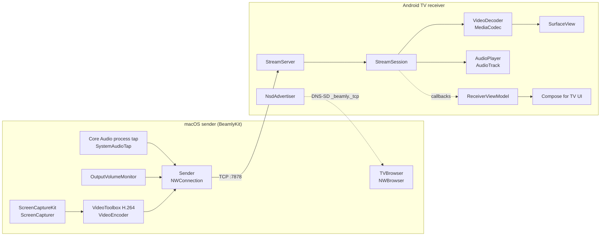

# Architecture

Beamly has two halves that talk over the [Beamly wire protocol](PROTOCOL.md):

## macOS (`macos/`)

A Swift package with three products:

| Target | Kind | Purpose |
|--------|------|---------|
| `BeamlyKit` | library | Everything that streams: capture, encoding, audio, networking, discovery |
| `BeamlyCLI` | executable `beamly` | Command-line sender |
| `BeamlyApp` | executable, bundled into `Beamly.app` | Menu bar app (AppKit) |

### BeamlyKit components

| Type | Responsibility | Queue |
|------|----------------|-------|
| `StreamSession` | Public entry point; wires the components, reports `StreamEvent`s on the main queue, idempotent stop | main (events) |
| `Sender` | `NWConnection`, packet framing, HELLO/PING/BYE, congestion tracking | `app.beamly.net` |
| `ScreenCapturer` | `SCStream` setup, frame filtering, drops frames while congested, ScreenCaptureKit audio fallback | `app.beamly.capture`, `app.beamly.audio` |
| `VideoEncoder` | `VTCompressionSession`, AVCC → Annex-B, CONFIG before key frames | VideoToolbox callback |
| `SystemAudioTap` | Global Core Audio process tap + private aggregate device, resampling to 48 kHz s16 | `app.beamly.tap` |
| `OutputVolumeMonitor` | Default output device volume/mute listeners → `VOLUME` packets | `app.beamly.volume` |
| `TVBrowser` | DNS-SD browsing, de-duplication by name | `app.beamly.browser` → main |
| `PacketCodec` | Pure encoding functions, unit-tested against shared fixtures | — |
| `SessionCrypto`, `RecordCipher` | Pairing commitment and code, session key derivation, AES-256-GCM records (CryptoKit) | `app.beamly.net` |
| `TrustStore` | This Mac's identity key and the paired TVs, in `~/Library/Application Support/Beamly/` | any (locked) |

### Audio routing

With **Play Sound Only on TV** (default), audio is captured by a Core Audio process tap whose `muteBehavior` is
`.muted`: applications' audio is diverted to Beamly and never reaches the Mac's speakers. The output device itself
is untouched, so the volume keys still work; `OutputVolumeMonitor` converts the volume to a linear gain using the
device's own dB curve and sends it to the TV. If the tap cannot be created (for example, permission denied),
Beamly falls back to ScreenCaptureKit audio and the Mac keeps playing sound.

## Android TV (`android/`)

Single-activity app, package `app.beamly.tv` (application ID `com.mac2tv.receiver` for upgrade compatibility).

| Package | Contents |
|---------|----------|
| `net` | `Protocol` and `SessionCrypto` (pure Kotlin, JVM-tested), `StreamServer`, `StreamSession` (handshake, pairing, streaming), `PairingStore`, `NsdAdvertiser`, `DeviceInfo` |
| `media` | `VideoDecoder` (MediaCodec), `AudioPlayer` (AudioTrack) |
| root | `MainActivity`, `ReceiverViewModel` (UI state) |
| `ui` | Compose for TV screens and components, theme |

### Threading

- `StreamServer` runs an accept loop on `Dispatchers.IO`. Each accepted socket gets a handshake coroutine that
  waits for the first byte before it may replace the active session (see the protocol's Happy Eyeballs note).
- `StreamSession.run()` blocks an IO thread: it reads packets, feeds `VideoDecoder` synchronously and queues audio.
- `AudioPlayer` writes to `AudioTrack` on its own thread and drops audio when its queue exceeds 120 ms.
- `ReceiverViewModel` receives listener callbacks on IO threads and publishes `StateFlow`s; callbacks from any
  session other than the active one are ignored.
- The server runs between `onStart` and `onStop`, so the TV only advertises while Beamly is on screen.

### Pairing and encryption

The handshake runs on the session thread before any media is accepted (protocol §6). For pairing, the session
reports the code to `ReceiverViewModel` and keeps reading packets; the user's Allow/Deny answer is picked up after
the next packet, which arrives within a second because the Mac pings every second. After `SESSION_START`,
`PacketReader` and `PacketWriter` switch to `RecordCipher` for their direction. On the Mac, `Sender` runs the same
state machine on its network queue and reports the code through `StreamEvent.pairing`.

### UI states

`Starting → Waiting ⇄ (Pairing →) Connecting → Streaming`, plus `Failed` (port unavailable) and the
Paired Macs screen reachable from Waiting. The waiting screen shows the
reason the previous session ended (sender stopped, connection lost, protocol error, incompatible version).

## Design decisions

| Decision | Reason |
|----------|--------|
| Raw H.264 over TCP instead of WebRTC/RTSP | No dependencies, lowest latency on a LAN, trivial to debug |
| Uncompressed PCM audio | ~1.5 Mbit/s is negligible on a LAN and avoids codec latency |
| Render on decode, ignore PTS | Mirroring favours latency over smoothness |
| Heartbeat + BYE instead of TCP close detection | FIN is not reliably delivered when the sender exits |
| Own handshake (P-256 ECDH + HKDF + AES-GCM) instead of TLS or Noise | No third-party dependencies on either platform; X25519 needs Android 12, P-256 works on Android 8 |
| Numeric comparison instead of a PIN typed on the Mac | Same security as Bluetooth SSP numeric comparison without a password-authenticated key exchange library |
| Process tap instead of muting the output device | macOS unmutes the device when volume keys are pressed |
